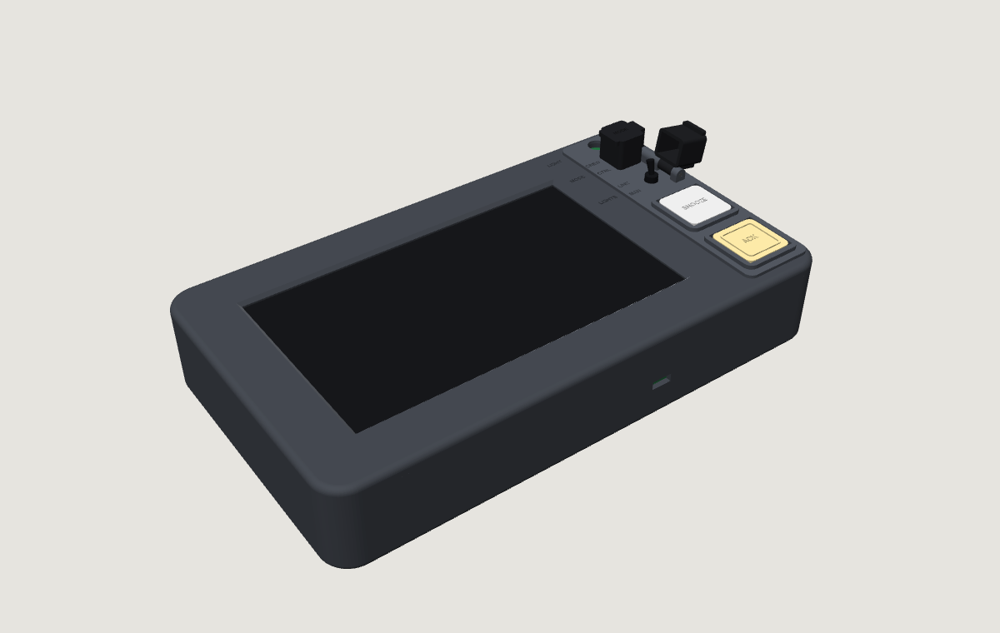

# Lunar Sleep-Shift Scheduling Tool

An offline crew sleep, light and nap scheduler for lunar habitats, built for NASA HUNCH. It predicts each crew member's body clock, plans the days before a sudden schedule change ("slam shift"), drives habitat lighting, and stores every action in a crash-safe log. It runs on a battery-powered Raspberry Pi tablet with spacecraft-style controls.



Designed to NASA standards with documented tailoring; not certified. See the [tailoring matrix](docs/03-tailoring-matrix.md).

**New to the team? Start with [docs/00-start-here.md](docs/00-start-here.md)**, then the [team plan](docs/10-team-plan.md) and [CONTRIBUTING.md](CONTRIBUTING.md).

## Run it on a laptop

Needs Python 3.10+ and Node 18+. Nothing else for the software.

```sh
git clone https://github.com/RLblueline/lunar-sleep-shift-scheduler.git && cd lunar-sleep-shift-scheduler
python3 web/build.py
(cd service && python3 -m lsst_service)    # then open http://127.0.0.1:8642; Ctrl+C to stop
```

Every hardware driver is simulated on a laptop. The Systems tab has buttons for the ACK and SNOOZE keys, the LIGHTS, MODE and TEST switches, the charger and the battery level. Opening `web/dist/index.html` straight from disk also works, as a browser-only demo without durable storage or hardware.

**On the Raspberry Pi:** read, then run, [deploy/pi/setup.sh](deploy/pi/setup.sh). It changes how the Pi boots.

## Check it

From the repo root, in a second terminal:

```sh
node --test tests/js/*.test.js                 # engine and planner
python3 -m unittest discover -s tests/py       # data service, hardware, enclosure report
python3 tools/trace.py                         # everything + docs/traceability.md
python3 tools/powercut_harness.py --cycles 10000   # long kill-9 durability run
```

`tools/trace.py` exits non-zero while any test fails or a testable requirement has no test. It currently lists 51 requirements: 37 verified by test, 10 by inspection, demonstration or analysis, and 4 open: PRC crossover, per-person body-clock period (not built yet), corner and edge radii, and battery review. The [team plan](docs/10-team-plan.md) assigns each one.

## CAD

```sh
pip install cadquery trimesh rtree   # laptop only
python3 cad/check.py                 # design-rule checks -> docs/09-hardware-checks.md
python3 cad/build.py                 # STEP assembly, print-ready STLs, 3D viewer -> cad/out/
```

Open `cad/out/tablet.step` in Fusion, Onshape or FreeCAD, or `cad/out/viewer.html` in a browser. CI also builds these on every push; download them from the run's artifacts.

## Repository map

| Path | Contents |
| --- | --- |
| `engine/engine.js` | Circadian model, readiness, Slam-Shift planner (deterministic, shared by UI and tests) |
| `web/src/` | Crew, Controller, Systems and Validation screens; local and service-backed stores |
| `service/lsst_service/` | Python data service: event log, recovery, HTTP API, hardware drivers |
| `cad/` | Parametric tablet model, design-rule checker, exporter, 3D viewer |
| `deploy/pi/`, `deploy/pico/` | Pi setup, systemd unit, kiosk; Pico power-cut test rig |
| `tests/` | JS and Python tests; each name starts with the requirement ID it verifies |
| `tools/` | Traceability report, kill-9 harness, boot report, GitHub issue creator |
| `docs/` | NASA document set: classification, requirements, tailoring, hazards, model credibility, architecture, verification, hardware, team plan |

## Status

| Area | State |
| --- | --- |
| Software | Working end to end on a laptop with simulated hardware |
| Data integrity | 3-copy fsynced log, majority-vote repair, kill-9 tested |
| Tablet hardware | Drivers and tests done; not yet built or run on a real Pi |
| CAD | All design-rule checks pass; 3 values wait on NASA tables or reviews |
| Model validation | PRC crossover and readiness fitting open (OI-1, OI-2) |
