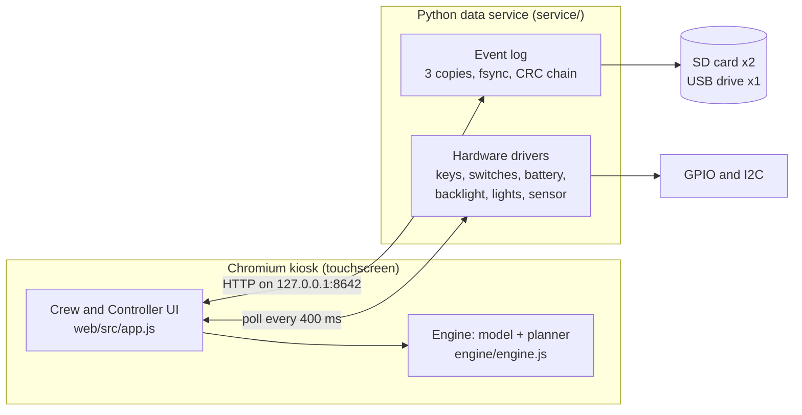

# Start here

This is the onboarding guide for the Lunar Sleep-Shift team. Read it once, run the app, and you'll know enough to pick up an issue. It takes about 30 minutes.

## 1. The problem in one paragraph

Lunar missions change the crew's schedule suddenly. A docking moves 4 hours earlier, or an EVA lands in the middle of the night. These are called **slam shifts**. The body clock can only move about 1 to 1.5 hours a day, so a crew that just "sleeps earlier" arrives at the critical task tired. Our tool predicts each person's body clock and plans the days before the event: when to sleep, nap, and seek or avoid bright light. It runs offline on a hand-held tablet, because a lunar habitat can lose its link to Earth for hours.

## 2. Science you need (10 minutes)

| Term | What it means | Where it lives in the code |
| --- | --- | --- |
| Circadian clock | The roughly 24 h internal clock in the brain (the SCN). Light is its main input. | `engine/engine.js`, `deriv()` and `step()` |
| Intrinsic period (τ, "tau") | How long one cycle takes with no light cues, about 24.2 h on average, different for each person | `tau` on each crew record |
| CBTmin | Core body temperature minimum, about 2 h before natural wake. The clock's reference point. | `cbtMins()` |
| Phase response curve (PRC) | Light before CBTmin delays the clock (later); light after CBTmin advances it (earlier) | `prc()`, Validation screen |
| Process S | Sleep pressure: rises while awake, falls during sleep | readiness calculation |
| Sleep inertia | Grogginess right after waking, about 20 min | readiness calculation |
| Readiness | Our 0–100 alertness score combining clock, sleep pressure, debt and inertia. **Weights are placeholders** (open item OI-2). | `band()`, crew screen |
| Light modes | ISS lighting presets: 6500 K phase-shift (blue-rich), 4500 K general, 2700 K pre-sleep | `service/lsst_service/hardware/lights.py` |

The model is the Forger, Jewett & Kronauer (1999) light-driven oscillator, integrated with RK4 in 6-minute steps. It's deterministic: the same inputs always give exactly the same outputs. Recovery and testing depend on that.

## 3. How the system fits together



Three rules hold everything together:

1. **The log is the truth.** Every action is a record appended to the event log. The UI rebuilds its state by replaying the log (`reduce()` in `app.js`). Nothing else is saved.
2. **A write is real only after it is on disk in all three copies.** The service fsyncs every copy before answering, so the screen can never show something a power cut could erase.
3. **The tool advises; people decide.** Plans explain themselves, schedule changes need two-step approval, and lights follow the plan only when the LIGHTS switch says LINK.

## 4. Run it (5 minutes)

You need Python 3.10+ and Node 18+. No other packages for the software.

```sh
git clone <repo url> && cd lunar-sleep-shift
python3 web/build.py
cd service && python3 -m lsst_service
```

Open http://127.0.0.1:8642. Then try:

- **Crew tab.** Drag the mission clock. Watch the screen go from white (alert light) to amber to deep red (wind-down).
- **Systems tab → Tablet hardware.** Press the simulated ACK and SNOOZE buttons, flip LIGHTS and MODE, and set the battery to 4 % with the charger unplugged.
- **Systems tab → Fault injection.** It's locked until you flip the simulated TEST switch on. Then corrupt a copy of the log and watch the boot log repair it.
- **Controller tab.** Draft a slam shift, look at the reasoning, and approve it in two steps.
- **Validation tab.** See the PRC, the entrainment check and the Monte Carlo spread.

## 5. Where things are

| Folder | What's in it | Main owner |
| --- | --- | --- |
| `engine/` | Circadian model, readiness, Slam-Shift planner | Model & science |
| `web/src/` | UI: `shell.html` (layout, CSS), `app.js` (screens), `store-*.js` (storage) | Software & UI |
| `service/lsst_service/` | Data service: event log, HTTP API, hardware drivers | Software & UI |
| `cad/` | Parametric tablet model, design-rule checker, exporter, 3D viewer | Hardware & CAD |
| `deploy/` | Raspberry Pi setup, systemd unit, kiosk, Pico power-cut rig | Software & UI + Hardware |
| `tests/` | Every test name starts with the requirement ID it checks | Everyone |
| `tools/` | Traceability report, kill-9 durability harness, boot report | Systems lead |
| `docs/` | The NASA document set (numbered 01 to 10) | Systems lead |

## 6. The document set, in reading order

| Doc | Read it when |
| --- | --- |
| [01 Software classification](01-software-classification.md) | You want to know why we follow NPR 7150.2 Class C |
| [02 Requirements](02-requirements.md) | Before any change: find the requirement your work serves |
| [03 Tailoring matrix](03-tailoring-matrix.md) | You need to know which NASA rules we meet, partly meet or deviate from |
| [04 Hazard analysis](04-hazard-analysis.md) | You touch planning, approval or lights |
| [05 Model credibility](05-model-credibility.md) | You touch the model (NASA-STD-7009) |
| [06 Architecture](06-architecture.md) | You touch the service, API or storage |
| [07 Verification plan](07-verification-plan.md) | You add a test or prepare a demo |
| [08 Hardware design](08-hardware-design.md) | You touch the tablet, wiring or CAD |
| [09 Hardware checks](09-hardware-checks.md) | Generated by `cad/check.py`; don't edit |
| [10 Team plan](10-team-plan.md) | You want to know who does what, and when |
| [traceability](traceability.md) | Generated by `tools/trace.py`; don't edit |

## 7. Glossary

| Word | Meaning |
| --- | --- |
| FDR | Final Design Review, the HUNCH milestone we're working toward |
| HUNCH | NASA's High school students United with NASA to Create Hardware program |
| Slam shift | A sudden change to the crew schedule |
| Hold-and-Mitigate | Planner choice when there isn't time to shift: keep the clock, use naps and light to cover the critical block |
| Critical block | A task that must not be slept through (docking, EVA) |
| Safe Mode / Degraded | Boot states: no usable data, or data lost and reported |
| SSLA | The ISS Solid State Lighting Assembly, the source of our light presets |
| Tailoring | Meeting a NASA requirement a different way, with a written reason |
| OI-n / HW-OI-n | Open items in the model credibility and hardware docs |
| DEV-n | Deliberate deviations from a NASA convention, awaiting sign-off |
