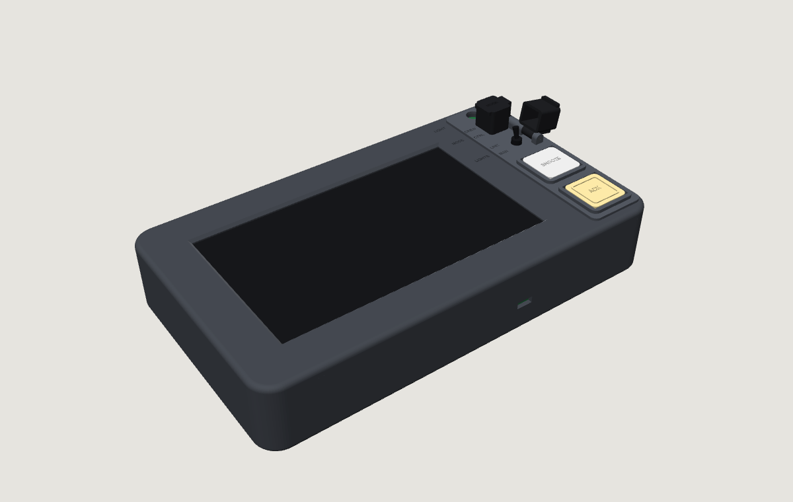
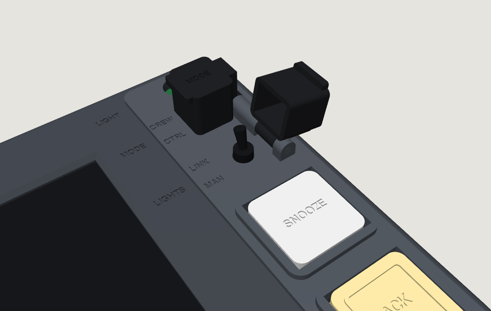
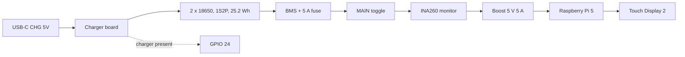

# Hardware design: the tablet

A battery-powered, 3D-printed tablet that runs the Lunar Sleep-Shift software on a Raspberry Pi 5 with the 7 in Touch Display 2. Outer size 240 × 138 × 43 mm (58.5 mm deep over the switch covers), about 770 g (estimate until the unit is built). Runtime is not yet estimated: 25.2 Wh of cells against a Pi 5 and display drawing roughly 5 to 8 W suggests 3 to 4 h, to be measured (HW-OI-5).

The model is parametric: `cad/tablet.py` holds every dimension, `cad/check.py` verifies the design rules ([09-hardware-checks.md](09-hardware-checks.md)), and `cad/build.py` exports a STEP assembly, print-ready STLs and a 3D viewer.



## Layout

```
 ┌──────────────────────────────────────────────────────────┬──────────────┐
 │                                                          │   (sensor)   │  LIGHT: TSL2591 behind a 9 mm window
 │                                                          │ CREW ┌────┐  │
 │                 7 in touchscreen                    MODE │ CTRL │cover│ │  bat-handle toggle under a flip-up cover
 │                 (155.5 × 88 mm viewing area)             │ LINK ┌────┐  │
 │                                                   LIGHTS │ MAN  │cover│ │  bat-handle toggle under a flip-up cover
 │                                                          │  [ SNOOZE ]  │  24 mm square key in a raised collar
 │                                                          │  [  ACK   ]  │  24 mm square, red backlight, raised ring
 └──────────────────────────────────────────────────────────┴──────────────┘
 Top edge (rear view): MAIN and TEST toggles in recessed wells, recessed PWR key, exhaust slots
 Right edge: LIGHT OUT (GX12-5, keyed)      Bottom edge: CHG 5V (USB-C)
 Rear: battery door, compute hatch with intake slots, tether loop, VESA 75 inserts
```

The control panel follows spacecraft practice:

- **Latching functions are bat-handle toggles.** The lever position shows the state at a glance, even with the screen off.
- **Momentary actions are square keys** in raised collars. ACK has a raised ring so it can be found by touch.
- **Every toggle is guarded.** LIGHTS and MODE sit under black flip-up covers like those on aircraft and race-car switches: lift the cover by its 2 mm tab, flip the switch. The covers are black, not red, because NASA-STD-3001 Appendix F ties red to emergency and warning, and neither switch is an emergency control. MAIN and TEST sit in recessed wells on the top edge.
- **The panel is a separate printed overlay,** held by the two toggle nuts and VHB tape, so the bezel prints face-down without support.



## Design rules applied

| Rule | Value | Source |
| --- | --- | --- |
| Rounded corners and edges | R13 plan-view corners, R3 front and rear edges | NASA-STD-3001 V2 9009, 9011 (table values to confirm) |
| Guarded controls | Covers, recessed wells, recessed power key; TEST also gated in software | V2 10027 |
| Glove-sized controls | Keys 24 mm square, 10 mm apart; toggles 22 mm apart | V2 10070 (Table 10.4-4 to confirm) |
| Labels | Every control and connector engraved; front labels 2.8 mm tall | V2 9118, 10066 |
| Connectors | Keyed GX12 and USB-C on different faces | V2 9029, 9030, 9032 |
| Grasp and restraint | Control-strip grip, tether loop, VESA 75 | V2 9016 |
| Indicator | One red LED, ≤ 30 % duty | OCHMO-TB-026 |
| FDM printing | 2.4 mm walls, no overhang steeper than 45° over 25 mm², bridges ≤ 20 mm, teardrop holes, heat-set inserts | Team rule (REQ-HW-005) |

## Power chain



The charger has no power path (HW-OI-1): charge with MAIN off until it is replaced.

## Pin map (Raspberry Pi 5, BCM numbers)

| Function | GPIO | Connects to | Notes |
| --- | --- | --- | --- |
| ACK key | 17 | Tactile switch to GND | Internal pull-up; counted on press |
| SNOOZE key | 5 | Tactile switch to GND | Internal pull-up |
| LIGHTS toggle | 27 | Up (LINK) throw to GND | Open wire reads MAN: lights stay put (safe) |
| MODE toggle | 6 | Down (CTRL) throw to GND | Open wire reads CREW: crew screen (safe) |
| TEST toggle | 22 | Up (on) throw to GND | Open wire reads off; fault tools also need the build flag |
| Charger present | 24 | Collector of an NPN whose base sees the charger's 5 V through 10 kΩ (4.7 kΩ to GND) | Active low: charger present pulls GPIO 24 to GND |
| PWR key | — | Pi 5 J2 power-button header (no GPIO) | Press to boot after a shutdown; hold 5 s to force off |
| ACK backlight | 23 | Red 3 mm LED + 1 kΩ | PWM, capped at 30 % duty |
| Cool white PWM | 12 | LIGHT OUT pin 1 via MOSFET | 6500 K channel |
| Warm white PWM | 13 | LIGHT OUT pin 2 via MOSFET | 2700 K channel |
| Red PWM | 18 | LIGHT OUT pin 3 via MOSFET | |
| I2C SDA / SCL | 2 / 3 | INA260 (0x40), TSL2591 (0x29) | |

## Bill of materials

| Qty | Part | Use |
| --- | --- | --- |
| 1 | Raspberry Pi 5 (4 GB) + Active Cooler | Compute |
| 1 | Raspberry Pi Touch Display 2, 7 in | Screen |
| 1 | Pi 5 RTC backup cell | Keeps the mission clock through a dead battery |
| 2 | Protected 18650 Li-ion cells (same batch) | Battery, 1S2P |
| 1 | 1S BMS + 5 A blade fuse and holder | Battery protection |
| 1 | Pololu U3V70F5 boost (5 V, 5 A) or equal | Pi supply |
| 1 | USB-C Li-ion charger board (1S) | Charging |
| 1 | Adafruit INA260 | Battery voltage and current |
| 1 | Adafruit TSL2591 | Light sensor |
| 2 | Bat-handle toggles, SPDT, 1/4-40 bushing (front) | LIGHTS, MODE |
| 2 | Miniature toggles, SPST (edge) | MAIN (power), TEST |
| 3 | 12 × 12 mm tactile switches + perfboard | ACK, SNOOZE (one board), PWR |
| 1 | 3 mm red LED (620 nm) + 1 kΩ resistor | ACK backlight |
| 1 | GX12-5 panel socket and plug | LIGHT OUT |
| 1 | 2 mm steel pin, 39 mm long | Cover hinge |
| 6 | M3 × 35 socket screws + M3 × 5.7 heat-set inserts | Bezel to shell |
| 8 | M2.5 heat-set inserts + M2.5 × 6 screws | Pi and display stand-offs |
| 4 | M4 heat-set inserts | VESA 75 mount |
| 1 | 3-channel logic-level MOSFET board (e.g. IRLZ44N × 3) | Drives LIGHT OUT |
| 1 | 12 V LED panel: cool white, warm white and red strips, plus its own 12 V supply | Habitat light stand-in for the demo |
| 1 | NPN transistor (2N3904) + 10 kΩ and 4.7 kΩ resistors | Charger-present sense |
| 1 | 0.5 mm foam gasket tape, VHB tape, 12 mm webbing | Display seal, overlay, tether |
| — | 22 AWG silicone wire (power), 28 AWG ribbon (signals), JST-XH connectors | Wiring |

## Printing

PETG, 0.4 mm nozzle, 6 perimeters, 25 % gyroid infill. STLs in `cad/out/stl/` are already in print orientation; no supports needed.

| Part | Orientation | Notes |
| --- | --- | --- |
| Rear shell | Rear face down | Largest part, 240 × 138 mm: needs a 250 × 210 mm bed |
| Front bezel | Front face down | Engraved labels print on the bed side |
| Control panel overlay | Back face down | Ream the hinge holes to 2.1 mm (slip fit) |
| Battery door, compute hatch | Outer face down | |
| Key caps | Top down | Translucent PETG so the ACK LED shows through |
| Switch covers (2) | Top down | Black PETG, 100 % infill; ream the pin hole to 1.95 mm (press fit) |
| Power key cap | Flange down | |

## Assembly order

1. Press heat-set inserts into the bezel, Pi and display stand-offs and VESA bosses.
2. Wire the battery pack: cells, BMS, fuse, MAIN toggle, INA260, boost. Test the 5 V output on a bench before connecting the Pi.
3. Mount the Pi on its stand-offs; fit the RTC cell; connect the display ribbon.
4. Fit the edge toggles and power key into the top-edge wells.
5. Fit the GX12 and USB-C boards. Wire LIGHT OUT through the MOSFET board.
6. Mount the display behind the bezel on foam tape; screw it to its posts.
7. Fit the tactile board, LED and key caps; fit the front toggles through the bezel and overlay, then tighten the nuts.
8. Slide the hinge pin through the overlay knuckles and press both covers onto it.
9. Close the shell with six M3 × 35 screws. Fit the doors.
10. Run `deploy/pi/setup.sh`, then the checks in [07-verification-plan.md](07-verification-plan.md).

## Open items

| ID | Item | Close by |
| --- | --- | --- |
| HW-OI-1 | Charger has no power path: charging while running may not terminate cleanly | Charge with MAIN off, or switch to a power-path charger |
| HW-OI-2 | Corner and edge radii, control size and spacing not yet checked against the NASA-STD-3001 tables (the requirement text is confirmed; the tables are images on nasa.gov) | Read Tables 9.3-1, 9.3-2, 10.4-4 and App. F F.5-1 from the PDF |
| HW-OI-3 | Battery design not yet reviewed against JSC 20793 | Mentor review; cell certificates |
| HW-OI-4 | Module envelopes and display stand-off positions are assumed (VERIFY) | Measure real parts; update `Params` and the `bought()` envelopes |
| HW-OI-5 | Mass, runtime and thermal figures are estimates | Weigh; 10-minute stress test (SoC < 80 °C); log runtime with the INA260 |
| HW-OI-6 | State of charge is voltage-based (about ±10 %) | Add coulomb counting from the INA260 current |
| HW-OI-7 | Switch covers turn on a press-fit pin and could drift open in microgravity (V2 10077); hinge gap not yet finger-tested for pinching (V2 9013) | Add an O-ring friction washer or a closed-position detent; finger and glove test on the printed unit |
